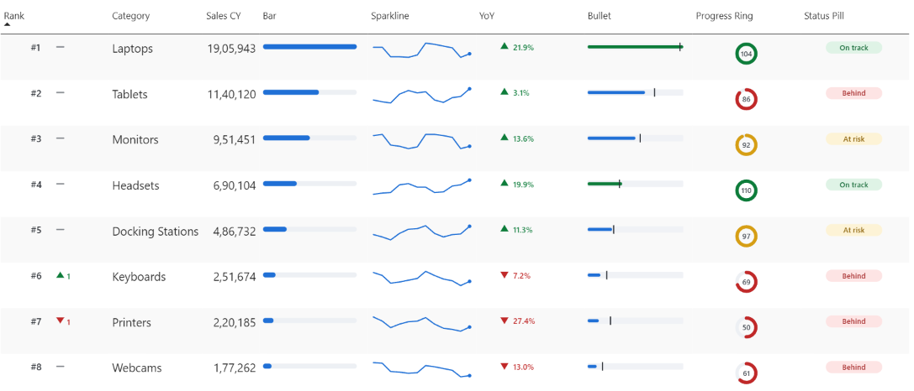
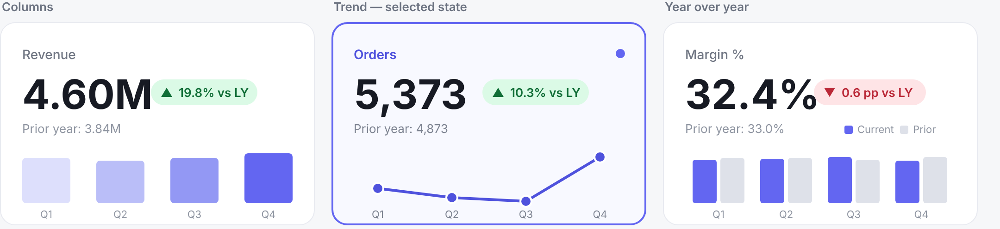

# Power BI techniques

Working demo files for Power BI techniques built with DAX rather than custom visuals. Each folder has its own write-up and a `.pbix` you can open and take apart — all with synthetic data generated by calculated tables, so there is no data source to reconnect.

---

## [SVG measures in tables](svg-tables/)

Turn a plain table into a dashboard. Seven measures that render bars, sparklines, variance arrows, progress rings, bullet charts, status pills and rank-movement badges — inside the rows of the stock table visual.

---

## [Clickable KPI cards](clickable-kpi-cards/)

KPI cards that are also slicers. Click a card to switch metric; the selected card restyles itself and every other visual follows. A second slicer swaps all four cards between three designs at runtime.

---

## The common thread

Both rest on one idea: **a DAX measure can return a string, and if that string is valid SVG prefixed with a data URI, setting the measure's data category to Image URL makes Power BI draw it.** Because it is a measure, it recalculates with filter context — so one design serves many values, and the graphic responds to slicers like any other number.

The traps are shared too, and each write-up covers them in detail:

- a bare `%` inside a data URI is an escape character and silently corrupts the image — write `&#37;`
- `#` terminates a data URI, so use `rgb()` rather than hex
- `LEN()` counts `&#37;` as six characters, which breaks any layout maths driven by string length
- a visual cannot filter itself, which is why selection lives in a slicer rather than the cards

---

Built with the [Power BI Modeling MCP server](https://marketplace.visualstudio.com/items?itemName=analysis-services.powerbi-modeling-mcp).
