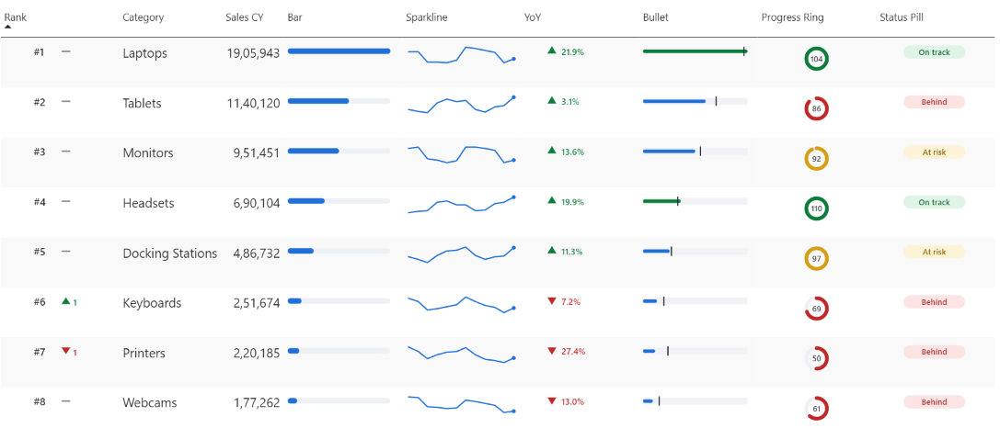

# SVG measures in Power BI tables

Turn a plain Power BI table into a dashboard using nothing but DAX measures that return SVG markup. No custom visuals, no AppSource, no third-party components.



Every graphic in that table is a measure. The table is the stock Power BI table visual.

---

## How it works

A DAX measure can return a string. If that string is valid SVG markup prefixed with a data URI, and the measure's **data category** is set to **Image URL**, Power BI renders it as a graphic inside the row — and it responds to slicers like any other measure.

Three steps:

1. **Return a string.** Build SVG markup in DAX, prefixed with `data:image/svg+xml;utf8,`
2. **Set the category.** Select the measure → Measure tools → Data category → Image URL
3. **Drop it in a table.** Power BI draws it in the row.

`Image URL` has been a supported data category for years. Most people only ever use it for logos.

---

## Gotchas

Three constraints that will cost you an afternoon if nobody warns you:

**1. Use `rgb()` instead of hex.** The `#` character terminates a data URI. `fill='#2070D6'` silently fails. Either use `fill='rgb(32,112,214)'` or encode the hash as `%23`.

**2. Keep the returned string under 32,766 characters.** That's a hard limit on DAX string output, and exceeding it fails silently — you get a blank cell with no error.

**3. Set your row height before judging the result.** Format → Grid → Row height. At the default height everything looks cramped and you'll assume the measure is wrong. Match the column width to the SVG's declared `width` too, or Power BI scales it down and text inside goes fuzzy.

A fourth, less obvious one: write `#` as the XML entity `&#35;` when you genuinely need a hash *inside* the SVG — for example rendering a rank as `#1`. See `SVG Rank Move` below.

---

## The data

The demo model has one calculated table — no data source, so nothing to break when you open it.

```dax
Sales =
VAR _cats =
    DATATABLE (
        "Category", STRING,
        "Base", DOUBLE,
        "Growth", DOUBLE,
        {
            { "Laptops", 120000, 0.018 },
            { "Monitors", 68000, 0.009 },
            { "Keyboards", 24000, -0.006 },
            { "Headsets", 41000, 0.022 },
            { "Docking Stations", 33000, 0.014 },
            { "Webcams", 19000, -0.012 },
            { "Tablets", 87000, 0.006 },
            { "Printers", 29000, -0.019 }
        }
    )
VAR _months =
    SELECTCOLUMNS ( GENERATESERIES ( 1, 24, 1 ), "Month Index", [Value] )
VAR _grid =
    ADDCOLUMNS (
        CROSSJOIN ( _cats, _months ),
        "@Date", EOMONTH ( DATE ( 2025, 1, 1 ), [Month Index] - 1 ),
        "@Year", 2025 + INT ( DIVIDE ( [Month Index] - 1, 12 ) ),
        "@MonthNo", MOD ( [Month Index] - 1, 12 ) + 1,
        "@Sales", ROUND ( [Base] * ( 1 + [Growth] * [Month Index] ) * ( 1 + 0.18 * SIN ( [Month Index] * 0.9 + DIVIDE ( [Base], 8000 ) ) ) * ( 1 + 0.07 * COS ( [Month Index] * 2.3 ) ), 0 ),
        "@Target", ROUND ( [Base] * ( 1 + 0.012 * [Month Index] ) * 1.04, 0 )
    )
RETURN
SELECTCOLUMNS (
    _grid,
    "Category", [Category],
    "Date", [@Date],
    "Year", [@Year],
    "Month No", [@MonthNo],
    "Month", FORMAT ( [@Date], "MMM" ),
    "Sales", [@Sales],
    "Target", [@Target]
)
```

192 rows: 8 categories × 24 months, January 2025 through December 2026.

---

## Base measures

The SVG measures read from these rather than from columns directly, so you can repoint them at your own model by changing only this section.

```dax
Total Sales   = SUM ( Sales[Sales] )
Total Target  = SUM ( Sales[Target] )

Sales CY      = CALCULATE ( [Total Sales], Sales[Year] = 2026 )
Sales PY      = CALCULATE ( [Total Sales], Sales[Year] = 2025 )
Target CY     = CALCULATE ( [Total Target], Sales[Year] = 2026 )

YoY %         = DIVIDE ( [Sales CY] - [Sales PY], [Sales PY] )
Attainment %  = DIVIDE ( [Sales CY], [Target CY] )
```

Ranking, with `ALLSELECTED` so it recalculates against whatever the user has filtered to:

```dax
Rank CY =
VAR _v = [Sales CY]
RETURN
IF (
    NOT ISBLANK ( _v ),
    RANKX ( ALLSELECTED ( Sales[Category] ), [Sales CY], , DESC, DENSE )
)

Rank PY =
VAR _v = [Sales PY]
RETURN
IF (
    NOT ISBLANK ( _v ),
    RANKX ( ALLSELECTED ( Sales[Category] ), [Sales PY], , DESC, DENSE )
)

Rank Change =
VAR _c = [Rank CY]
VAR _p = [Rank PY]
RETURN
IF ( NOT ISBLANK ( _c ) && NOT ISBLANK ( _p ), _p - _c )
```

Format string for `Rank Change`: `+0;-0;0`

---

## The SVG measures

Set every one of these to data category **Image URL**.

### 1. Bar

An in-row bar scaled to the largest category in the current selection. Two rectangles: a grey track, then a coloured fill.

```dax
SVG Bar =
VAR _val = [Sales CY]
VAR _max = MAXX ( ALLSELECTED ( Sales[Category] ), [Sales CY] )
VAR _w = ROUND ( DIVIDE ( _val, _max ) * 186, 0 )
RETURN
IF (
    ISBLANK ( _val ),
    BLANK (),
    "data:image/svg+xml;utf8,"
        & "<svg xmlns='http://www.w3.org/2000/svg' width='200' height='24' viewBox='0 0 200 24'>"
        & "<rect x='0' y='7' width='186' height='10' rx='5' fill='rgb(237,240,244)'/>"
        & "<rect x='0' y='7' width='" & _w & "' height='10' rx='5' fill='rgb(32,112,214)'/>"
        & "</svg>"
)
```

Because `_max` uses `ALLSELECTED`, the bars re-scale when the user filters the table.

### 2. Sparkline

Twelve months of trend with an end-point marker. `CONCATENATEX` builds the `points` attribute of a `<polyline>`.

```dax
SVG Sparkline =
VAR _w = 170
VAR _h = 34
VAR _pts =
    CALCULATETABLE (
        ADDCOLUMNS ( VALUES ( Sales[Month No] ), "@v", [Total Sales] ),
        Sales[Year] = 2026
    )
VAR _min = MINX ( _pts, [@v] )
VAR _max = MAXX ( _pts, [@v] )
VAR _n = COUNTROWS ( _pts )
VAR _line =
    CONCATENATEX (
        _pts,
        ROUND ( DIVIDE ( Sales[Month No] - 1, _n - 1 ) * ( _w - 8 ) + 4, 0 ) & ","
            & ROUND ( _h - 5 - DIVIDE ( [@v] - _min, _max - _min ) * ( _h - 10 ), 0 ),
        " ",
        Sales[Month No], ASC
    )
VAR _lastV = MAXX ( FILTER ( _pts, Sales[Month No] = _n ), [@v] )
VAR _lastY = ROUND ( _h - 5 - DIVIDE ( _lastV - _min, _max - _min ) * ( _h - 10 ), 0 )
RETURN
IF (
    _n < 2,
    BLANK (),
    "data:image/svg+xml;utf8,"
        & "<svg xmlns='http://www.w3.org/2000/svg' width='" & _w & "' height='" & _h & "' viewBox='0 0 " & _w & " " & _h & "'>"
        & "<polyline points='" & _line & "' fill='none' stroke='rgb(32,112,214)' stroke-width='2' stroke-linejoin='round' stroke-linecap='round'/>"
        & "<circle cx='" & _w - 4 & "' cy='" & _lastY & "' r='3' fill='rgb(32,112,214)'/>"
        & "</svg>"
)
```

Each month maps to an x position; each value maps between `_min` and `_max` to a y position. The circle on the final point is what makes it readable at row height.

Power BI has native sparklines now, and they are fine. Reach for this when you need control they do not give you — custom colours, markers, baselines.

### 3. Year-over-year arrow

A direction triangle plus the percentage, both coloured by sign.

```dax
SVG YoY Arrow =
VAR _y = [YoY %]
VAR _up = _y >= 0
VAR _col = IF ( _up, "rgb(13,124,58)", "rgb(192,40,40)" )
VAR _tri = IF ( _up, "7,3 13,13 1,13", "7,15 1,5 13,5" )
VAR _lbl = FORMAT ( ABS ( _y ) * 100, "0.0" ) & "&#37;"
RETURN
IF (
    ISBLANK ( _y ),
    BLANK (),
    "data:image/svg+xml;utf8,"
        & "<svg xmlns='http://www.w3.org/2000/svg' width='90' height='20' viewBox='0 0 90 20'>"
        & "<polygon points='" & _tri & "' fill='" & _col & "'/>"
        & "<text x='20' y='15' font-family='Segoe UI' font-size='12' font-weight='600' fill='" & _col & "'>" & _lbl & "</text>"
        & "</svg>"
)
```

Note `&#37;` — the percent sign is written as an XML entity. A literal `%` starts a URI escape sequence and will corrupt the string.

### 4. Progress ring

A donut showing target attainment, drawn with `stroke-dasharray`.

```dax
SVG Progress Ring =
VAR _p = [Attainment %]
VAR _dash = ROUND ( MIN ( _p, 1 ) * 88, 0 )
VAR _col =
    SWITCH (
        TRUE (),
        _p >= 1, "rgb(13,124,58)",
        _p >= 0.9, "rgb(214,158,20)",
        "rgb(192,40,40)"
    )
VAR _lbl = FORMAT ( _p * 100, "0" )
RETURN
IF (
    ISBLANK ( _p ),
    BLANK (),
    "data:image/svg+xml;utf8,"
        & "<svg xmlns='http://www.w3.org/2000/svg' width='40' height='40' viewBox='0 0 40 40'>"
        & "<circle cx='20' cy='20' r='14' fill='none' stroke='rgb(237,240,244)' stroke-width='5'/>"
        & "<circle cx='20' cy='20' r='14' fill='none' stroke='" & _col & "' stroke-width='5' stroke-linecap='round' stroke-dasharray='" & _dash & " 88' transform='rotate(-90 20 20)'/>"
        & "<text x='20' y='24' text-anchor='middle' font-family='Segoe UI' font-size='11' font-weight='600' fill='rgb(60,66,74)'>" & _lbl & "</text>"
        & "</svg>"
)
```

The trick: a circle of radius 14 has a circumference of 2 × π × 14 ≈ **88**. Setting `stroke-dasharray` to `<percentage × 88> 88` draws exactly that fraction of the ring. `rotate(-90)` moves the start point to twelve o'clock.

Change the radius and you must change the 88 to match.

### 5. Bullet chart

Actual against target, in one column.

```dax
SVG Bullet =
VAR _a = [Sales CY]
VAR _t = [Target CY]
VAR _max = MAXX ( ALLSELECTED ( Sales[Category] ), MAX ( [Sales CY], [Target CY] ) )
VAR _aw = ROUND ( DIVIDE ( _a, _max ) * 180, 0 )
VAR _tx = ROUND ( DIVIDE ( _t, _max ) * 180, 0 )
VAR _col = IF ( _a >= _t, "rgb(13,124,58)", "rgb(32,112,214)" )
RETURN
IF (
    ISBLANK ( _a ),
    BLANK (),
    "data:image/svg+xml;utf8,"
        & "<svg xmlns='http://www.w3.org/2000/svg' width='190' height='22' viewBox='0 0 190 22'>"
        & "<rect x='0' y='5' width='180' height='12' rx='2' fill='rgb(240,242,246)'/>"
        & "<rect x='0' y='8' width='" & _aw & "' height='6' rx='3' fill='" & _col & "'/>"
        & "<rect x='" & _tx & "' y='3' width='2' height='16' fill='rgb(40,44,50)'/>"
        & "</svg>"
)
```

The bar turns green once it passes the target tick.

### 6. Status pill

A rounded badge driven by thresholds.

```dax
SVG Status Pill =
VAR _p = [Attainment %]
VAR _txt =
    SWITCH ( TRUE (), _p >= 1, "On track", _p >= 0.9, "At risk", "Behind" )
VAR _bg =
    SWITCH ( TRUE (), _p >= 1, "rgb(223,243,230)", _p >= 0.9, "rgb(253,243,214)", "rgb(253,228,228)" )
VAR _fg =
    SWITCH ( TRUE (), _p >= 1, "rgb(13,100,48)", _p >= 0.9, "rgb(140,98,8)", "rgb(160,30,30)" )
RETURN
IF (
    ISBLANK ( _p ),
    BLANK (),
    "data:image/svg+xml;utf8,"
        & "<svg xmlns='http://www.w3.org/2000/svg' width='86' height='22' viewBox='0 0 86 22'>"
        & "<rect x='0' y='2' width='84' height='18' rx='9' fill='" & _bg & "'/>"
        & "<text x='42' y='15' text-anchor='middle' font-family='Segoe UI' font-size='11' font-weight='600' fill='" & _fg & "'>" & _txt & "</text>"
        & "</svg>"
)
```

The status reads as a word, not only a colour — which matters for anyone who cannot distinguish the red from the green.

### 7. Rank with movement

Current rank, plus an arrow showing places gained or lost since last year.

```dax
SVG Rank Move =
VAR _rc = [Rank CY]
VAR _d = [Rank Change]
VAR _col =
    SWITCH (
        TRUE (),
        _d > 0, "rgb(13,124,58)",
        _d < 0, "rgb(192,40,40)",
        "rgb(132,136,142)"
    )
VAR _mark =
    SWITCH (
        TRUE (),
        _d > 0, "<polygon points='46,5 52,14 40,14' fill='" & _col & "'/>",
        _d < 0, "<polygon points='46,14 40,5 52,5' fill='" & _col & "'/>",
        "<rect x='40' y='9' width='12' height='2' rx='1' fill='" & _col & "'/>"
    )
VAR _lbl = IF ( _d = 0, "", FORMAT ( ABS ( _d ), "0" ) )
RETURN
IF (
    ISBLANK ( _rc ),
    BLANK (),
    "data:image/svg+xml;utf8,"
        & "<svg xmlns='http://www.w3.org/2000/svg' width='74' height='22' viewBox='0 0 74 22'>"
        & "<text x='2' y='16' font-family='Segoe UI' font-size='14' font-weight='600' fill='rgb(40,44,50)'>&#35;" & _rc & "</text>"
        & _mark
        & "<text x='56' y='16' font-family='Segoe UI' font-size='12' font-weight='600' fill='" & _col & "'>" & _lbl & "</text>"
        & "</svg>"
)
```

This is where the hash problem bites hardest. Writing `"#" & _rc` produces `#1`, and that `#` terminates the data URI — everything after it is discarded and the cell comes back blank. Written as `&#35;` it renders correctly.

A flat grey dash means no change, so the column never looks broken when nothing moved.

---

## Building the visual

1. Drop a **Table** visual on the canvas
2. Add `Category`, then `Sales CY`, then the SVG measures
3. Format → Grid → **Row height**: around 40px
4. Widen each SVG column to roughly its declared width (200, 170, 90, 40, 190, 86, 74)

If a column is narrower than the SVG, Power BI scales the image down and any text inside goes blurry.

---

## Accessibility

SVG measures reach a screen reader as an image with no alt text. Never let colour or shape carry meaning on its own — pair every arrow, ring or pill with the number or word beside it, as `SVG Status Pill` and `SVG YoY Arrow` do here.

---

## Notes

The data in this file is synthetic, generated by the calculated table above. There is no data source and no connection — open it and everything works.

Built with the [Power BI Modeling MCP server](https://marketplace.visualstudio.com/items?itemName=analysis-services.powerbi-modeling-mcp).
