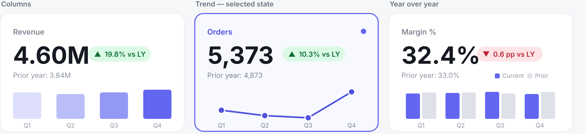

# Clickable KPI cards in Power BI

KPI cards that are also slicers — built entirely from DAX measures returning SVG, with no custom visuals. Click a card to switch metric; the selected card restyles itself and every other visual follows.

A second slicer lets the viewer swap between three card designs at runtime.



---

## What it does

Four cards — Revenue, Orders, Avg Order Value, Margin % — each showing a value, a year-over-year delta pill, a prior-year comparison and a quarterly chart. Clicking one:

- restyles that card to a selected state (indigo border, tint, indicator dot)
- switches the detail chart to that metric
- updates the chart's title and colour

A style slicer swaps all four cards between **Columns**, **Trend** and **Year over year** layouts without rewiring anything.

---

## How it works

Three ideas stacked on each other.

### 1. A measure can return SVG

Set a measure's data category to **Image URL** and return a string beginning `data:image/svg+xml;utf8,`. Power BI renders it as a graphic. Because it's a measure, it recalculates with filter context — which is what lets one card design serve four different metrics.

### 2. A disconnected table drives the selection

`KPI Selector` holds one row per metric and has **no relationship to anything**. That is the point. A slicer filters it; `SELECTEDVALUE` reads what survived:

```dax
Selected KPI = SELECTEDVALUE ( 'KPI Selector'[KPI], "Revenue" )
```

Every value measure then switches on that:

```dax
KPI Value =
SWITCH (
    [Selected KPI],
    "Revenue", [Revenue CY],
    "Orders", [Orders CY],
    "Avg Order Value", [AOV CY],
    "Margin %", [Margin % CY]
)
```

Join that table to the fact table and the pattern collapses.

### 3. The Button Slicer handles the selected state

The Button Slicer supports **images per state**. Give the Default state the plain card measure and the Selected state a variant drawing the active styling. The slicer decides which shows.

This matters because of a hard constraint: **a visual cannot filter itself.** Put the cards in a Matrix and each cell resolves to its own KPI — the measure has no way to know which cell you clicked. You get Power BI's native dim, nothing custom. The Button Slicer sidesteps it entirely by owning selection natively.

---

## Gotchas

Every one of these cost real time to find.

**A bare `%` corrupts a data URI.** `%` begins an escape sequence. Write it as the XML entity `&#37;` inside SVG. This bites on any percentage-formatted KPI — a model that works perfectly on Revenue and Orders will fail on Margin %.

**`#` terminates a data URI.** Use `rgb(99,102,241)`, never `#6366F1`. The exception is conditional formatting — `KPI Color` returns hex because it isn't going into a URI. Same model, opposite rules.

**`LEN()` counts `&#37;` as six characters.** Any layout maths driven by string length will be wildly wrong wherever a percent appears. Measure the collapsed string instead:

```dax
VAR _numW = ROUND ( LEN ( SUBSTITUTE ( _lbl, "&#37;", "%" ) ) * 25, 0 )
```

A pill ran 44px off the card edge before this was caught — and only on one of the four metrics.

**The Button Slicer's image field accepts measures only.** A calculated column with data category Image URL will not appear in the field well, even though the documentation shows columns being used. Write the icon as a measure reading `SELECTEDVALUE` of its own row.

**Don't put two metrics on the switching chart.** The detail chart takes `KPI Value Monthly` alone — one measure that becomes whichever metric is selected. Two fixed measures means two fixed series that nothing can change.

**Percentage points, not percent, for a ratio.** Margin falling from 33.0% to 32.4% is **0.6 pp**, not "1.8% lower". `KPI Delta` special-cases this.

---

## Model

Two tables, no relationships between them.

| Table | Rows | Purpose |
|---|---|---|
| `Sales` | 384 | Synthetic fact: 4 regions × 4 categories × 24 months (2025–2026) |
| `KPI Selector` | 4 | Disconnected. One row per metric |
| `Card Style` | 3 | Disconnected. One row per card design |

`Sales` is a DAX calculated table — no data source, nothing to reconnect when you open the file.

### Measure folders

```
Sales          1 Base measures          Total Revenue, Total Cost, Total Orders, Margin %, Avg Order Value
               2 Time intelligence      Revenue/Orders/AOV/Margin CY and PY
               6 Region cards           SVG Region Card
KPI Selector   3 KPI switcher           Selected KPI, KPI Value, KPI Delta, labels
               4 Card images (default)  SVG Card Bars/Spark/YoY Default, SVG Card Default
               5 Card images (selected) SVG Card Bars/Spark/YoY Selected, SVG Card Selected
               8 Dynamic formatting     Detail Title, Detail Subtitle, KPI Color, Delta Color
Card Style     3 KPI switcher           Selected Style, SVG Style Thumb
```

Every measure carries a description explaining what it does and why — hover it in the field list.

---

## Setup

**KPI cards**

1. Insert a **Button Slicer**, field `KPI Selector[KPI]`
2. Format → Images → Image field, state **Default** → `[SVG Card Default]`
3. Same, state **Selected** → `[SVG Card Selected]`
4. Set the button size to 340×220 to match the SVG, or the text softens
5. Turn on single select

**Style switcher**

1. Second Button Slicer, field `Card Style[Style]`
2. Image field → `[SVG Style Thumb]`
3. Single select on, horizontal, small

**Detail chart**

1. Any chart; X axis `Sales[Quarter]`, Y axis `[KPI Value Monthly]` — one measure only
2. Filter `Sales[Year] = 2026`
3. Title → fx → Field value → `[Detail Title]`
4. Data colours → fx → Field value → `[KPI Color]`

No Edit interactions pass is needed. `KPI Selector` and `Card Style` are unrelated to each other and to `Sales`, so neither slicer can filter the other. That is a property of the model, not a setting.

---

## Accessibility

An SVG measure reaches a screen reader as an image with no alt text. Never let colour or shape carry meaning alone — every delta here pairs its arrow with the number, and the selected state uses five simultaneous cues (border weight, background tint, label colour, indicator dot, chart saturation) so it survives being screenshotted or viewed by someone who can't separate the hues.

